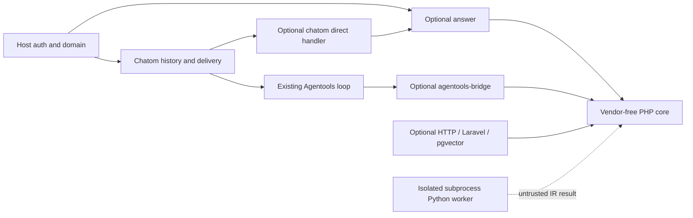

# Approved KnowKit architecture

This package materializes approved D1/D2 and generalized context extensions into [75 normative anchors](../../specs/architecture/architecture.md), a [versioned manifest](../../specs/architecture/manifest.v1.json), eight [ADRs](../adr/0001-independent-core-and-delivery.md) and the [threat model](threat-model.md). It records design authority; implementation, production readiness, release and publication require their own evidence.

Authority is the consolidated `knowledge/architecture` plus exact `knowledge/contracts#identity,#ports`, `knowledge/api#shapes`, `knowledge/access#contract`, `knowledge/locks#contract`, `knowledge/publication#contract`, `knowledge/disclosure#contract`, `knowledge/lifecycle#contract` and the final canonical registry refinement in `knowledge/extensibility#matrix`. These references are read through the plan read API. Detailed wire/schema definitions remain P1.4's deliverable. Historical audit suggestions and raw model answers do not compete with this contract.

D1 baseline provenance: `@plan/artifacts/opus-5.5-architecture.md`, SHA256 `10d860bd3a125aae6f54854639ef53d93678c10e80bde5f1bfff6d23e11c086a`. D2 expanded approval provenance: `@plan/artifacts/opus-5.5-amendment.md`, SHA256 `ed5bb638c1dc61c27db6e1cea7658a328648992f10892753e5b1caef0da76d49`. These preserve observed Opus 5.5 route evidence, not independently attested backend identity or approval of every later normative refinement. No model or review identity is attributed to this executor.

The current execution-input and consolidated contracts agree on `packages/core/src/Adapter`, namespace `KnowKit\Adapter`, and `Adapter\ProcessWorker\ProcessWorkerSupervisor` at v0.4. Earlier plural-path and v0.3 supervisor descriptions are historical.

The worker's result flow is not a PHP import edge: the worker depends only on versioned schemas, and PHP accepts its output independently. The core contains Domain/Application/Port/Registry/Adapter, PostgreSQL migrations and CLI; it has no vendor runtime dependencies. Edufy remains a host, with an optional first-adopter example, and no Edufy package or teaching domain enters core.

| Milestone | Approved delivery |
| --- | --- |
| v0.1 | Independent core/CLI, hostScopeHash, registry, navigation, connector port |
| v0.2 | Optional answer and Edufy example |
| v0.3 | Optional hybrid pgvector |
| v0.4 | Subprocess worker and ProcessWorkerSupervisor |
| v0.5 | Optional HTTP, Laravel and Chatom direct |
| v0.6 | Optional Agentools bridge preserving the existing loop |
| v1.0 | Contract freeze |

Run `python3 tools/check-spec-contract.py --specs specs --check architecture` from the repository root. The shorter default invocation and explicit `--group contract:architecture` remain supported. `--specs` selects the canonical `specs` directory relative to `--root` (or its absolute path); other directories and unknown checks are rejected. The stdlib checker validates the approved package/layer DAG, mandatory anchors and their contract markers, accepted ADRs and local references, fixture digests, mandatory executed case IDs, child exit codes and stable inputs. `--report <repository-relative-path>` writes the same JSON report emitted on stdout. Unknown groups, missing tests, zero tests, missing/skipped cases, failed children and modified inputs are failures. No Composer, future schemas or backend is needed. P1.2 integrates this command into its QA registry; the group manifest is [contract-architecture.json](../../tests/fixtures/check-groups/contract-architecture.json).

Versioned [fixtures](../../tests/contract/architecture/fixtures/v1/manifest.json) and their case IDs distinguish core independence, all four version axes, local revoke orderings and external-owner freshness. The fixture corpus is synthetic, licensed as private project material, and includes explicit digest rationale and expected outcomes. Digest changes require an intentional fixture version/rationale change; the checker has no snapshot-update mode.

These are architecture assertions and a small sequential contract model, not execution of the future PHP runtime, real PostgreSQL locks, provider delivery or host installs. They cannot establish concurrency, clean-install behavior or erase a remote-owner window. Those checks remain with the owning implementation items; required backend checks must fail when a backend is absent. The [reuse qualification](reuse.md) states exactly which donor patterns were adapted and which suites were not run.
